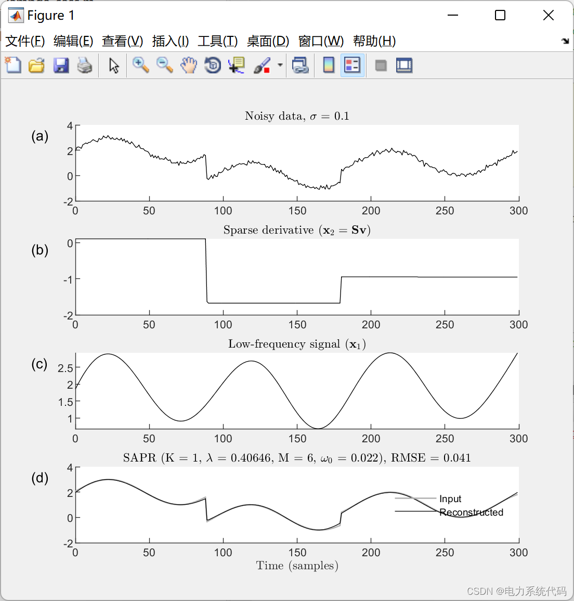
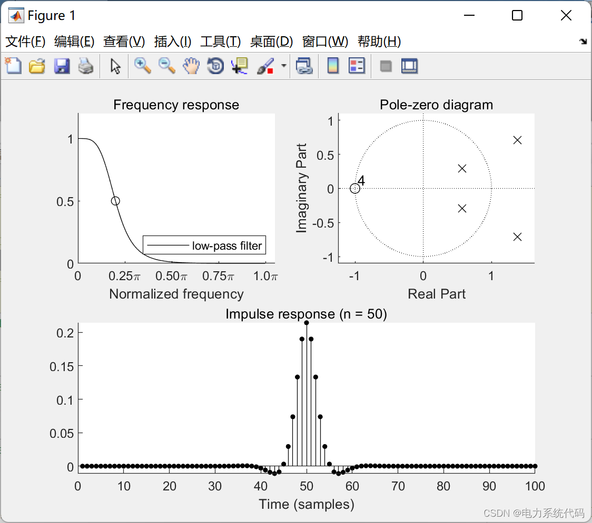
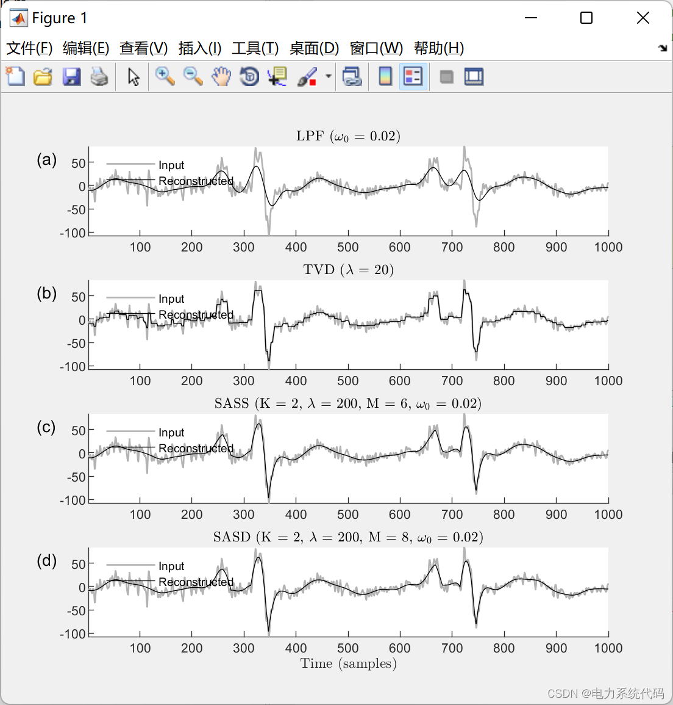
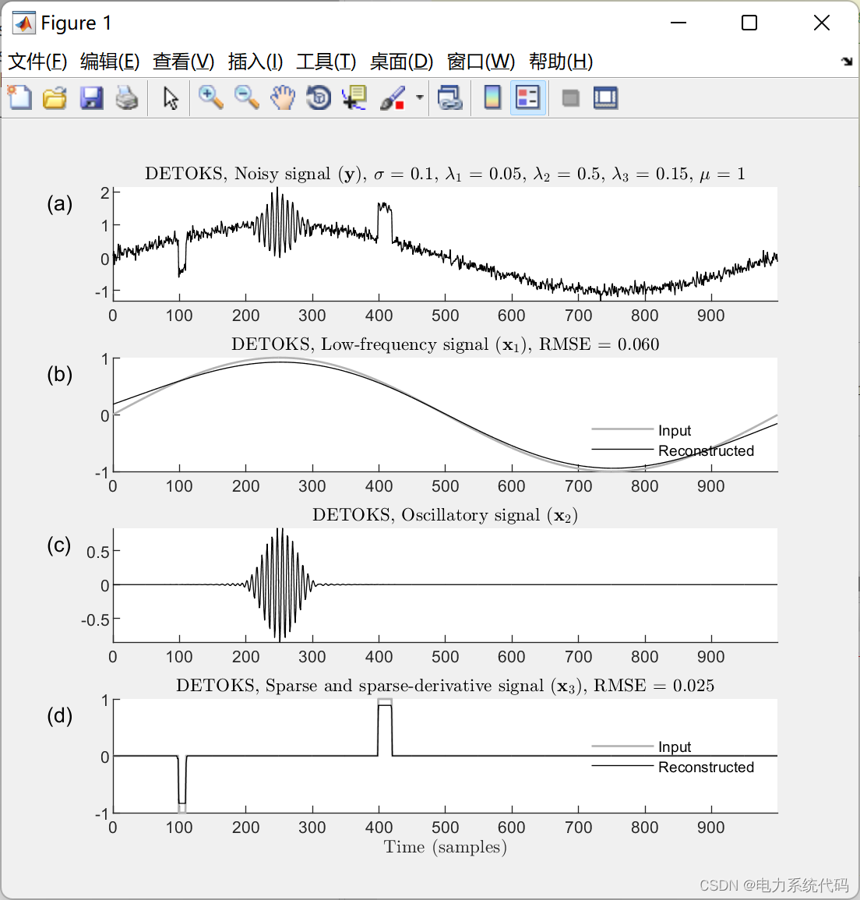
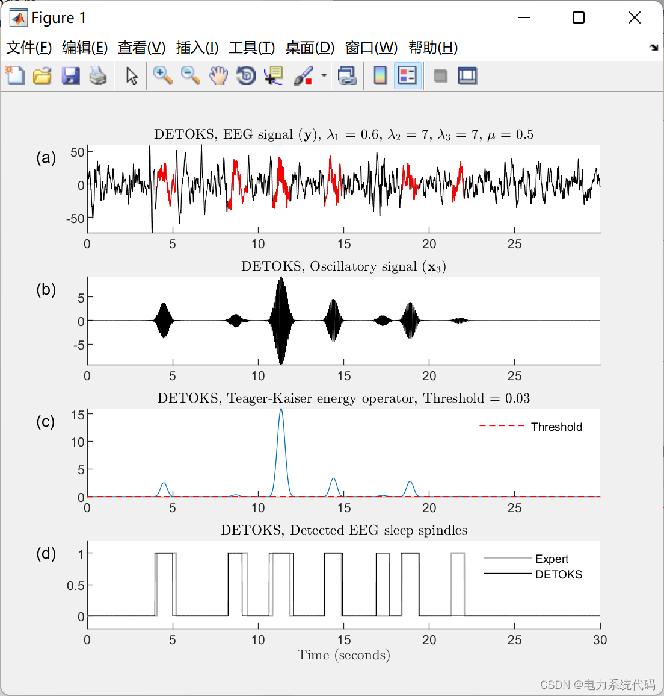
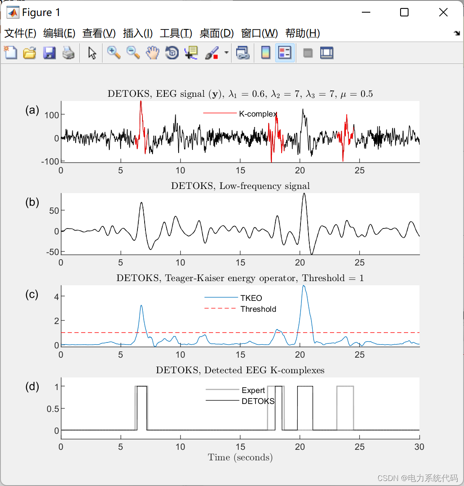
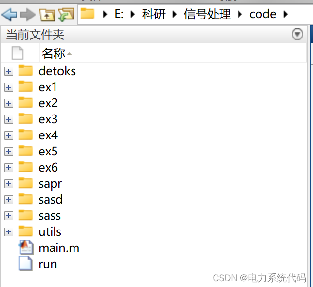
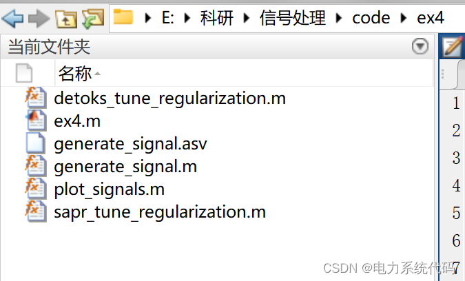
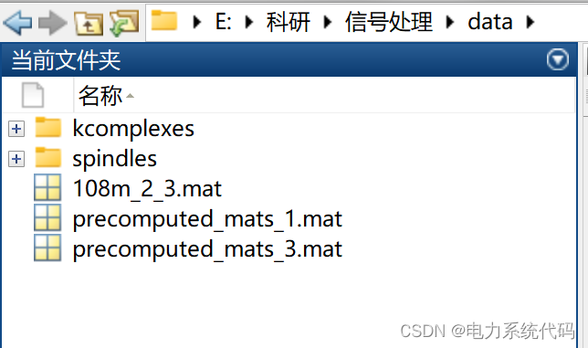

# MATLAB|Denoising and Pattern Recognition in Time Series Data with Sparse Auxiliary Signals

MATLAB|Denoising and pattern recognition in time-series data with sparse auxiliary signals
​  
Contents
I. Overview
II. Examples and Simulation
📢 Example 1:
📢 Example 2:
📢 Example Three:
📢 Example 4:
🔬Example 5:
📢 Example 6:
3. MATLAB Code Implementation
Editor
I. Overview
This paper addresses the signal denoising and pattern recognition issues in batch processing time series data by combining linear time-invariant filters, orthogonal multiresolution representations, and methods based on sparsity. It introduces a new method for designing high-order zero-phase lowpass, highpass, and bandpass infinite impulse response (IIR) filters using the spectral transformation of digital filter state space representations. Additionally, it presents a technique based on near-end gradients to factorize a class of special zero-phase highpass and bandpass IIR filters, ensuring that the factorization product maintains the zero-phase property of the filter, and incorporates sparse derivative components into the signal model. To showcase the novel filter design application, this paper validates and proposes a new signal model that simultaneously denoises and recognizes the desired patterns.First, the proposed filter design is used to test the existing signal model, which incorporates both a linear time-invariant (LTI) filter and a method based on sparsity. By integrating the proposed filter design with the existing signal model, a new signal model called Sparsity-Assisted Signal Denoising (SASD) is developed. Using simulation data, the robustness of the SASD signal model under different order filters and noise levels is demonstrated. Subsequently, a new signal model called Sparsity-Assisted Pattern Recognition (SAPR) is proposed and derived. In SAPR, LTI bandpass filters and methods based on sparsity are combined with orthogonal multiresolution representations (such as wavelets) to detect specific patterns in the input signal.Finally, this paper combines signal denoising and pattern recognition tasks, and derives a new signal model called Sparseness-Aided Signal Denoising and Pattern Recognition (SASDPR). Using sleep EEG data to detect K complexes and sleep spindles, the functions of SAPR and SASDPR framework are demonstrated.
II. Examples and Simulations 📢 Example One: The Sparse Augmented Signal Denoising (SASD) algorithm, which simultaneously combines the Full-Variation Denoising and Low-Pass Filtering for denoising noisy signals, thereby preserving the signal's discontinuities.
Editor
Case Study 2: Using a strip matrix to demonstrate zero phase filtering:
Editor
Example 3: Sparse Augmented Signal Denoising (SASD) algorithm simultaneously combines Total Variation Denoising and Low-Pass Filtering to denoise noisy signals, thereby preserving signal discontinuities. In this example, we use LPF, TVD, SASS, and SASD for denoising of ECG signals:
Editor
Example 4: Sparse Aided Signal Denoising and Pattern Recognition (SASDPR) will simultaneously denoise and detect the desired oscillation patterns in a given signal.
Editor
Case Study 5: Sparse Aided Signal Denoising and Pattern Recognition (SASDPR) will simultaneously denoise and detect the desired oscillation patterns in a given signal.
Editor
Example 6: Sparse Aided Pattern Recognition (SAPR) will detect wavelet patterns in the detection signal.
Editor
III. Matlab Code Implementation
function [y, f, s, x, w] = generate_signal( fs, sigma )\n\n%% Initialize noise level and signal length\nrng('default')\nN = 10*fs;\nn = 0:N-1;\n\n%% Generate low frequency synthesis components\nf = 0.1;\nf = sin(2*f/fs*pi*n);      \n\n%% Oscillation\ns = zeros(size(n));\no = 13;\ns(200+(1:fs)) = sin(2*pi*o/fs*(1:fs)) .* hamming(fs)';\n\n%% Sparse segmented constants\nx = zeros(size(n));\nx(100:110) = -1;\nx(400:420) = 1;\n\n%% Add noise\nw = sigma*randn(size(n));\ny = f+s+x+w;\n\nend\n\n  
%% plot_signals( y, x_ex3, kc, k, tk, th, binX, binA, method)\n%\n% Inputs:\n%   y       - Noise signal\n%   x_ex3   - Sleeping spindle signal\n%   k       - Detected k-combined wave signal\n%   tk      - Teager-Kaiser energy operator\n%   th      - Spindle detection threshold\n%   binX    - Binary vector\n%   binA    - Binary vector with algorithmic comment on the main axis\n%   method  - SASDPR/DETOKS\n%\n% Outputs:\n%   None\n\n%% ________________________________________________________________________\n%%\nfunction plot_signals( y, x_ex3, kc, k, tk, th, binX, binA, method)\n\nglobal simdata;\nfs = simdata.fs;\n\nif strcmp(method, 'DETOKS')\n    txt_1 = [method, ', EEG signal ($\mathbf{y}$), ','$\lambda_1$ = ', num2str(simdata.lam0_detoks), ...\n        ', $\lambda_2$ = ', num2str(simdata.lam1_detoks), ', $\lambda_3$ = ', num2str(simdata.lam2_detoks),...\n        ', $\mu$ = ', num2str(simdata.mu_detoks)];\n    txt_2 = [method, ', Low-frequency signal'];\n    txt_3 = [method, ', Teager-Kaiser energy operator, Threshold = ', num2str(simdata.th_detoks)];\n    txt_4 = [method, ', Detected EEG K-complexes'];\nelseif strcmp(method, 'SAPR')\n    txt_1 = [method, ', EEG signal ($\mathbf{y}$), ','$\lambda_1$ = ', num2str(simdata.lam0_sapr), ...\n        ', $\lambda_2$ = ', num2str(simdata.lam1_sapr), ', $\eta$ = ', num2str(simdata.eta_sapr),...\n        ', $\mu$ = ', num2str(simdata.mu_sapr)];\n    txt_2 = [method, ', K-Complex signal ($\mathbf{x}_2$)'];\n    txt_3 = [method, ', Teager-Kaiser energy operator, Threshold = ', num2str(simdata.th_sapr)];\n    txt_4 = [method, ', Detected EEG K-complexes'];\nend\n\nN = length(y);\nn = 0:N-1;\n\n%% Plot\nfigure('rend','painters','pos',[100 100 550 500]);\nclf\n\nsubplot(4,1,1);\ntext(-0.1,0.98,'(a)','Units', 'Normalized', 'VerticalAlignment', 'Top'); hold on;\nplot(n/fs, y, 'k'); hold on;\np0 = plot(n/fs, x_ex3, 'r'); hold off;\ntitle(txt_1,'interpreter','latex')\nlegend([p0], {'K-complex'},'location','north');\nlegend boxoff;\nset(gca, 'box', 'off')\naxis tight;\n\nsubplot(4,1,2);\ntext(-0.1,0.98,'(b)','Units', 'Normalized', 'VerticalAlignment', 'Top'); hold on;\np0 = plot(n/fs, kc, 'k'); hold on;\np1 = plot(n/fs, k, '--k'); hold off;\ntitle(txt_2,'interpreter','latex')\nif strcmp(method, 'SAPR')\n    legend([p1,p0], {'$\mathbf{\Psi} \mathbf{k}$', ...\n        '$\mathbf{B}^T \mathbf{B} \mathbf{\Psi} \mathbf{k}$'},'interpreter','latex', ...\n        'location','north');\n    legend boxoff;\nend\nset(gca, 'box', 'off')\naxis tight;\n\nsubplot(4,1,3);\ntext(-0.1,0.98,'(c)','Units', 'Normalized', 'VerticalAlignment', 'Top'); hold on;\np0 = plot(n/fs, tk); hold on;\np1 = plot(n/fs, th*ones(1,N), 'r--'); hold off;\ntitle(txt_3,'interpreter','latex')\nlegend([p0,p1], {'TKEO','Threshold'},'location','north');\nlegend boxoff;\nset(gca, 'box', 'off')\naxis tight;\n\nsubplot(4,1,4);\ntext(-0.1,0.98,'(d)','Units', 'Normalized', 'VerticalAlignment', 'Top'); hold on;\nplot(n/fs, binX, 'Color', [0,0,0]+0.7,'linewidth',1.0); hold on;\nplot(n/fs, binA, 'k');\ntitle(txt_4,'interpreter','latex')\nxlabel('Time (seconds)','interpreter','latex')\nlegend('Expert',method,'location','north');\nlegend boxoff\nset(gca, 'box', 'off')\nylim([-0.2, 1.2])\n\nprintme_pdf = @(ex,meth) print('-dpdf', sprintf('../../results/%s_%s',ex,meth));\nprintme_pdf('ex6',lower(method));\n\n% printme_eps = @(ex,meth) print('-depsc', sprintf('figures/%s_%s',ex,meth));\n% printme_eps('ex6',lower(method));\n\n\nend\n\n  
Program:  
Edit  
Edit  
Data:  
Edit

## Images

<!-- PAYMENT_BLOCK -->

## Get this dataset

- Payment link (Stripe): [Buy now](https://buy.stripe.com/3cs8yP7sY87d0vu9AB)
- Payment QR code: 

<!-- /PAYMENT_BLOCK -->
